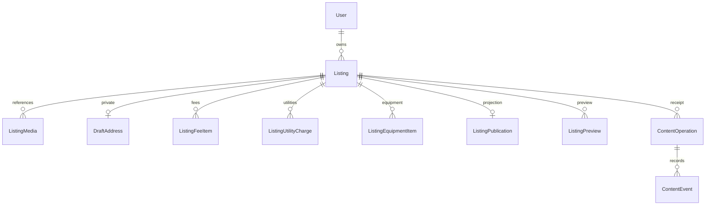

# 內容命令、版本與遷移

2026-11-12；第17個migration：20261112000000_content_commands。

圖中的邏輯關係不全是SQL FK：Operation、Preview、Publication、Event以最少快照識別關聯，操作收據不得因移權而改owner，不把私人內容複製進歷史結果。一般HTTP沒有任意CRUD或清除這些記錄的權限；保存與防復活窗口仍待PLAN-D03，未實作正式刪帳／永久清理。

## 欄位與不變條件

- Listing.revision為正整數；現有資料從1建立版本基準，不表示過往真的只有一次修改。publicId為伺服器不可猜識別，與私人位置無關。
- publicationHistory：既有firstPublishedAt可信非空標KNOWN；其他既有資料標UNKNOWN，不依status或publishedAt猜從未公開。遷移後新建預設NEVER，第一次成功發布才記首刊並標KNOWN；UNKNOWN合規重刊仍保持空值／待核對，不因缺漏而阻擋。保留原首刊防改trigger，沒有授權更正入口。
- ContentOperation同ownerId＋type＋requestKey唯一，保存目標與請求SHA-256摘要、當時revision／status。成功重送先回本人最少收據，再談目前內容；不能回新持有人的私人資料，也不重執行舊發布。
- ListingPreview只保留本人該內容最新預覽識別；綁revision及資格／證據來源摘要。不是授權、預留、永久內容快照或版本庫。
- ListingPublication只含受控公開快照；讀取端再驗白名單、版本、目前狀態及證據。沒有有效來源時不提供舊快取補位。
- ContentEvent和業務／收據在同一短交易提交；目前沒有完整dispatcher、lease、epoch、外部重試與告警，不宣稱07背景工作完成。

## 狀態與額度

無限制內容DRAFT／PUBLISHED／ARCHIVED分桶；受限者獨立；TRASHED不占三類房源筆數但圖仍保留且計量不得先釋放。必要公開下架不查封存位，草稿轉封存與一般回收恢復要查目標位。受限回收恢復保持限制，不直接公開、不用封存空位卡住。

trash保存當次trashedAt，restore在原時間＋30×86400秒前完成才可。截止當下即拒絕，不因worker未執行延長。DELETED已加入enum供後續模型相容，但沒有實作永久刪除API／清理，不把多一個enum當功能完成。

## 鎖與失敗

命令先帳戶User FOR UPDATE，再Listing；圖片沿相同順序。交易內重驗session，查原操作，對新命令才驗版本。相同key同body並發只一筆業務效果；同key不同body409，失敗提交前全部rollback。空patch／值相同不增加內容revision；圖片附加、實際排序變更、換封面、移除引用會增加，使舊預覽失效。

沒有跨DB／R2原子交易承諾；既有圖片仍用持久預留／清理證明，PENDING超時不冒充舊writer已停止。不因新增狀態操作就自動實體清圖。

## 正式套用門檻

已在臨時PostgreSQL重建／測試17個migration。沒有套正式或常駐開發庫，沒有reset、改寫已交付migration或自動發布。

新增publicId使用gen_random_uuid()，對既有大表可能涉及資料寫入與鎖；正式須按11先備份、估量鎖表／重建時間並演練。新應用依賴新欄／表，需先expand再導流；不把啟動程式當migration工具。舊版不認得新版狀態／操作契約時不可盲退；保留來源資料，另案安排相容回復。

City.publicationPolicy為OPEN／STOP_NEW／NOT_OPEN，另以UNKNOWN表示尚未核對的歷史狀態；不由舊isEnabled推測。新city預設NOT_OPEN，沒有新增對外營運地區管理捷徑；本批只在隔離fixture明確開啟TEST縣市。發布時對地區列加共享鎖，與停新刊變更序列化。
