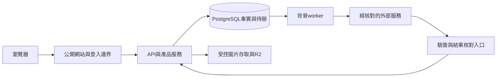

# 03 系統架構與環境

版本：2026-11-07規劃基準。依據：[01](01_需求與版本範圍.md)、[02](02_商業規則與狀態.md)。本章是後續實作設計，不表示現有程式已具備；本輪不修改程式或環境。章節、選型及驗證狀態統一見 [03～12總覽](03至12_規劃總覽與決策清單.md)。

## 03-01 現況與採用邊界

- 已存在：TypeScript／Node、Express、Prisma／PostgreSQL、私有R2 adapter及可注入服務；現有入口server→app→app-factory，auth／listings／entitlements／media分模組。
- 現有驗證基準曾為Node24.19、Prisma7.10.1、PostgreSQL17；不是「最新版本」宣告或版本保證。實作按lockfile重建，升級另核對引擎／相容性／回復，不為寫企劃換套件。
- apps/web與packages/contracts目前占位，不能當已有前端或共用契約；目前無完整發布、搜尋、金流與背景worker。15個migration存在不代表正式資料庫已遷移。
- 首發沿用單一模組化後端及PostgreSQL，不先拆微服務、另加搜尋叢集、Redis或新商業功能。需要隔離的是部署程序與責任，不要求每模組獨立服務。

## 03-02 系統分工

| 部分 | 設計責任 | 不可承擔／假設 |
| --- | --- | --- |
| 公開網站 | 搜尋、詳情、品牌、文章、比較與租補呈現；可服務端產出安全公開內容供分享／索引 | 不直連私有資料庫／R2，不把後台DTO當公開資料 |
| 會員／管理後台 | 私有表單、公開預覽、方案／帳務／查核案件及管理員分權 | 不在前端判定付款成功、管理權、額度或查核通過 |
| 網站伺服器層 | 同來源路由、公開服務端呈現、瀏覽器session邊界；可集中處理網站請求 | 前端具體框架／版本須與UI交付方確認，不假設已採Next.js或已有可用UI |
| API | 權限、產品驗證、交易、私有／公開投影及操作結果 | 不在資料庫交易內等待外部付款、定位或大量轉圖 |
| 背景worker | 持久工作、到期、通知、對帳、圖片清理、索引失效與復原 | 不把HTTP程序內定時器當可靠排程，不用重送當全新操作 |
| PostgreSQL | 權益／付款／狀態等事實、操作與事件、必要鎖及來源紀錄 | 網路成功不等於交易提交；公開快取不是事實來源 |
| R2／外部adapter | 私有資產及經核對的金流／郵件／LINE／地圖等能力 | R2不是SQL／API主機，Cloudflare帳號不等於應用已部署 |

邏輯路徑：瀏覽器→同來源網站→API→PostgreSQL；API提交事實及待辦→worker→外部服務→回寫可核對結果。付款webhook、Bot等外部入口直接走專用驗簽路由，不用瀏覽器session冒充授權。正式主機未選定；不可把雲端開發沙箱當正式網站。

### 目標分工圖（規劃，尚未部署）

## 03-03 模組界線

帳號與查核、方案與額度、支付與退款、房源與狀態、圖片與容量、公開搜尋與位置／分組、品牌文章卡片、匯入Bot、通知案件、租補各有服務邊界。跨模組透過明確交易／事件協作，不互相直接改不屬於自己的表。

- 身分通過、訂閱有效、工具可用、內容可公開是四種不同判斷；不以User.role或一個verified旗標概括。
- 狀態轉換按該操作適用條件核對持有人、帳戶、資格、限制、地區、版本、筆數、圖片／容量與確認意圖；必要下架／刪除不被滿額阻擋，純文字不套新增圖片門檻。局部檢查通過不能授權發布。
- 公開投影與私人工作內容分開；公開版在成功提交前不受未完成編輯覆蓋。隱私收緊時先阻止不安全舊輸出，不以等待重建索引維持洩漏。

## 03-04 環境與設定

| 環境 | 資料／用途 | 允許外部能力 |
| --- | --- | --- |
| 開發／隔離測試 | 明確測試資料；可重建，與正式帳號／DB分離 | Mock、隔離PostgreSQL、指定驗證桶；不自動跑真R2測試 |
| 預備驗收 | 去識別樣本、接近正式組裝及遷移演練 | 金流sandbox、測試Email／LINE名單、專用儲存／網域 |
| 正式 | 真實會員及正式交易 | 僅通過08／10／11門檻的服務與最小權限憑證 |

所有環境分開DB、bucket或受權限隔離的資源、webhook密鑰、OAuth回呼、通知寄送名單及日誌。啟動先驗設定與服務相依；缺能力顯示未就緒，不能用虛構免費／無限容量或關閉驗簽補位。秘密由平台秘密管理提供，不存Git、報告、前端或日誌。

正式非閒置休眠基準：開發可低成本／Hobby；正式API、必要worker與DB須採經核對的不因閒置休眠配置，工作區等級與服務規格分別確認。排程不依訪客流量喚醒，維護／重啟與故障仍須恢復機制。成長監控及擴容依09，非零故障／永不過載保證。

## 03-05 交易、時間及可恢復性

- API／worker均以UTC保存精確事件時間，對外Asia/Taipei；日期型欄位是台灣日曆日期，不能以瀏覽器時區改日。區間起含終不含，曆月、獎勵秒數、48h／72h／30天沿02。
- 帳戶層序列化涵蓋所有會改資格／筆數／資產的入口。跨帳號先依固定識別碼排序鎖帳戶，再按固定表／識別順序取得資格來源、內容、資產及操作鎖；不得網站、Bot、worker各用相反順序。
- 持鎖期間不呼叫外部服務；先準備／驗證，再短交易重核提交，外部工作持久化。死鎖或交易衝突只做有界、可冪等重試，不能要求客戶重付。
- 同一事件可能收到多次，業務效果一次：付款不重開資格、退款不多退、匯入不多筆、清理不重釋容量。跨DB／外部儲存不宣稱有原子交易，採可查操作狀態及補償。
- 讀取健康與就緒分開：health表示程序活著；readiness核對DB／必要設定與相依版本，個別金流／圖片功能另標就緒，不因一個200就開收費。

## 03-06 設計完成／驗收證據

需要：部署拓撲與正式／預備資源清單、前端交付技術確認、服務契約、鎖順序與失敗案例、設定清單、重啟後工作可續跑證據。本章界線已定義；實際主機、框架版本、資源與演練仍見總覽D01／D02及E依賴，不假定完成。
